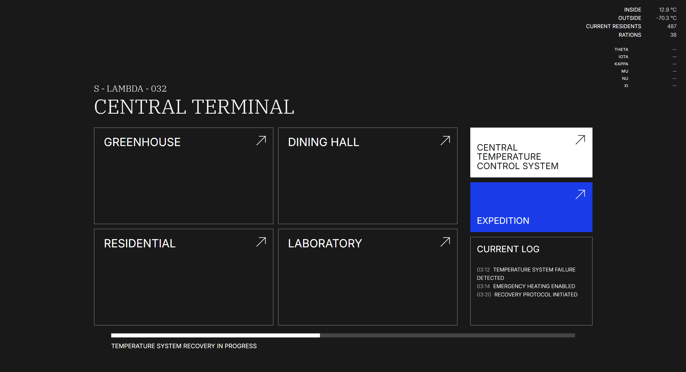
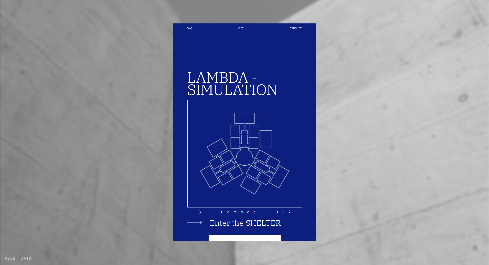
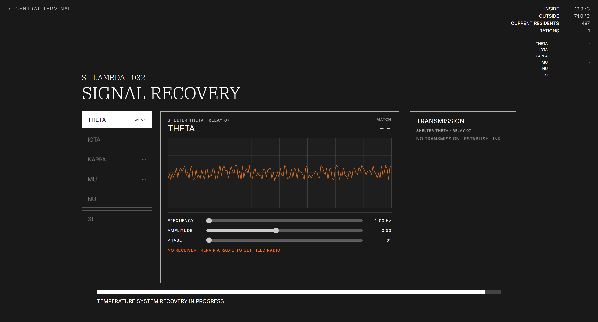
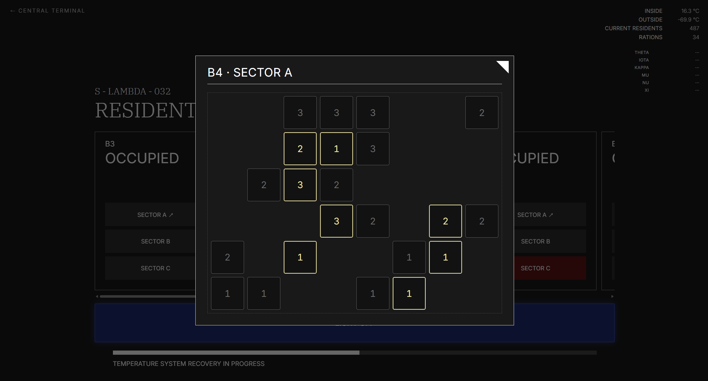

# SHELTER LAMBDA — CENTRAL ARCHIVE

> *we / are / endure*

얼어붙은 지상 아래, 487명이 살아가는 지하 셸터 **람다(S-LAMBDA-032)**.
당신은 중앙 터미널 앞에 앉아, 무너져 가는 셸터를 다시 살려야 합니다.

A short interactive worldbuilding game set in a frozen underground shelter.
Sit at the central terminal and bring Shelter Lambda back to life.

### [▶ 지금 플레이하기 / Play now](https://peachblood231-lgtm.github.io/shelter-lambda/)

브라우저에서 바로 플레이할 수 있어요. 설치나 로그인은 필요 없어요.
No install, no login — plays right in your browser.



---

## 세계 / The World

바깥 기온은 영하 72도. 중앙 온도제어시스템은 고장 났고, 식량은 부족합니다.
배급 기록에는 맞지 않는 숫자가 있고, 끊긴 줄 알았던 주파수 너머로 누군가 람다를 부르고 있습니다.

그리고 70년 동안, 아무도 람다 밖으로 나가지 않았습니다.

Outside, it is −72°C. The central heating system has failed and food is running low.
The ration records don't add up — and somewhere beyond the dead frequencies, someone is still calling Lambda.

For seventy years, no one has stepped outside.

---

## 할 수 있는 것 / What you can do

| | |
|---|---|
| **탐사 · Expedition** | 셸터의 아래층과 바깥으로 탐사대를 보내 부품, 식량, 기록을 찾아오세요. |
| **복구 · Recovery** | 찾아온 부품으로 온도제어시스템을 고치고, 열 분배 매트릭스를 맞추세요. |
| **신호 · Signal** | 고친 무전기로 파형을 맞춰 다른 셸터와 교신하세요. |
| **온실 · Greenhouse** | 씨앗을 심고 키워 식량을 수확하세요. 그리고… 불을 꺼 보세요. |
| **거주구역 · Residential** | 복구가 진행되면 잠겨 있던 구역이 열립니다. |
| **기록 · Archive** | 다이닝홀의 배급 기록 속 숨겨진 이야기를 읽어 보세요. |


---

## 플레이 팁 / Tips

- 진행 상황은 **내 브라우저에 자동 저장**돼요. 브라우저 기록을 지우면 처음부터 시작해요.
- 처음부터 다시 하고 싶으면 인트로 화면 왼쪽 아래 **RESET DATA**를 누르세요.
- 숨겨진 **업적**이 있어요. 평소라면 하지 않을 행동도 해 보세요.
- 컴퓨터 화면에서 가장 잘 보이고, 휴대폰에서도 플레이할 수 있어요.

- Progress is **saved automatically in your browser**.
- Press **RESET DATA** on the intro screen to start over.
- There are hidden **achievements**. Try things you normally wouldn't.

| | |
|---|---|
|  |  |
|  | |

---

## 스포일러 주의 / Spoiler warning

이 저장소의 `src/data` 폴더에는 무전 기록, 아카이브 문서, 업적 문구 등 **이야기 전체**가 들어 있어요.
먼저 플레이해 보시는 걸 추천해요.

The `src/data` folder contains the full story — transmissions, archive records, achievements.
Play first!

---

## 개발자용 / For developers

React + Vite로 만들었어요.

```bash
npm install
npm run dev
```

- 게임 내용(아이템, 탐사 난수표, 무전 기록 등)은 `src/data`의 JSON 파일에 있어요. 설명은 [`src/data/README.md`](src/data/README.md)
- `main` 브랜치에 push하면 GitHub Actions로 GitHub Pages에 자동 배포돼요.

---

© 2026 peachblood231. All rights reserved.